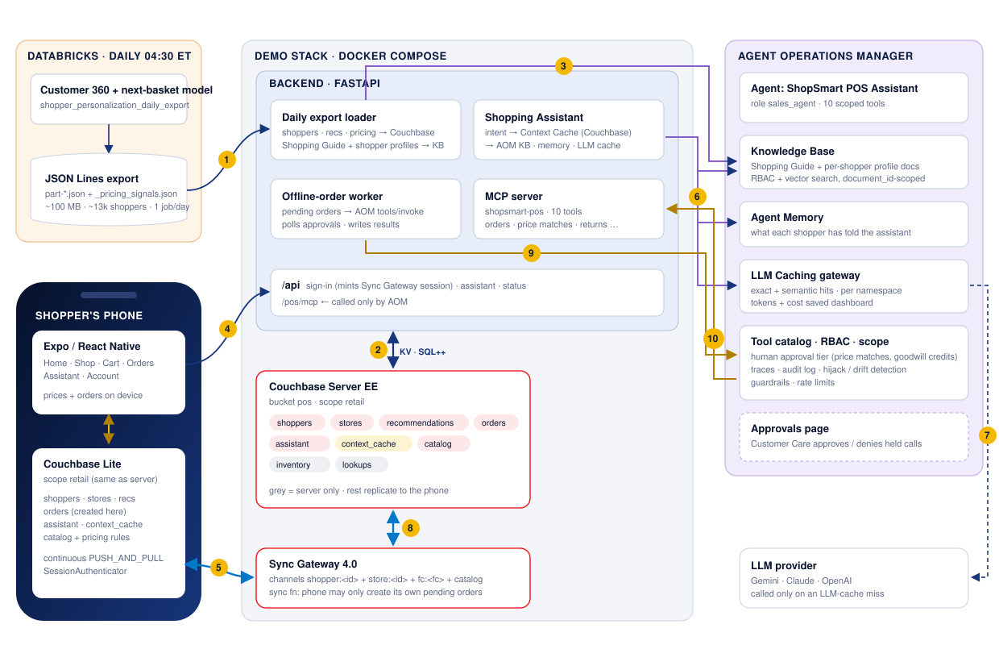
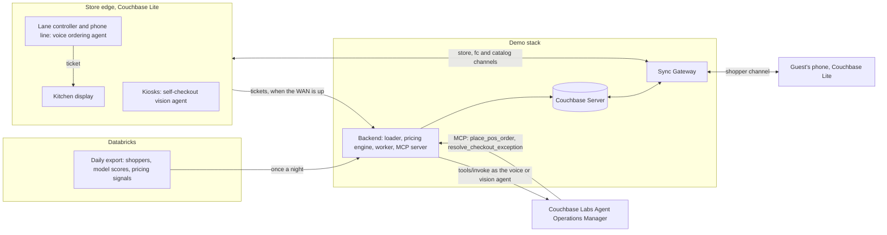
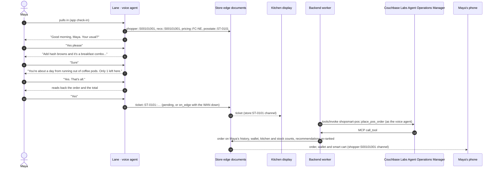
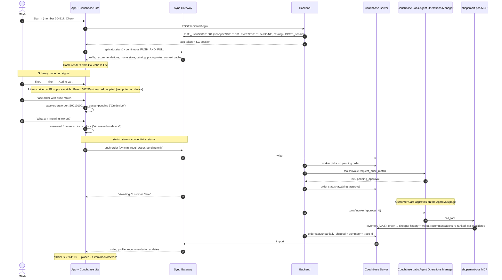
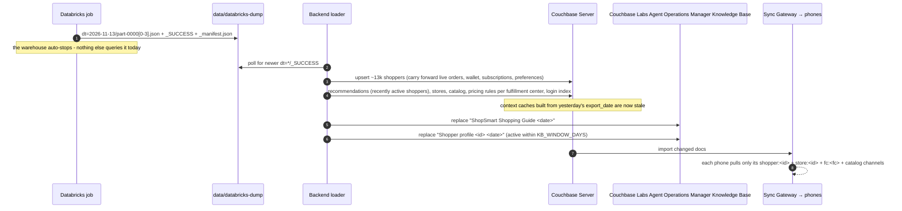
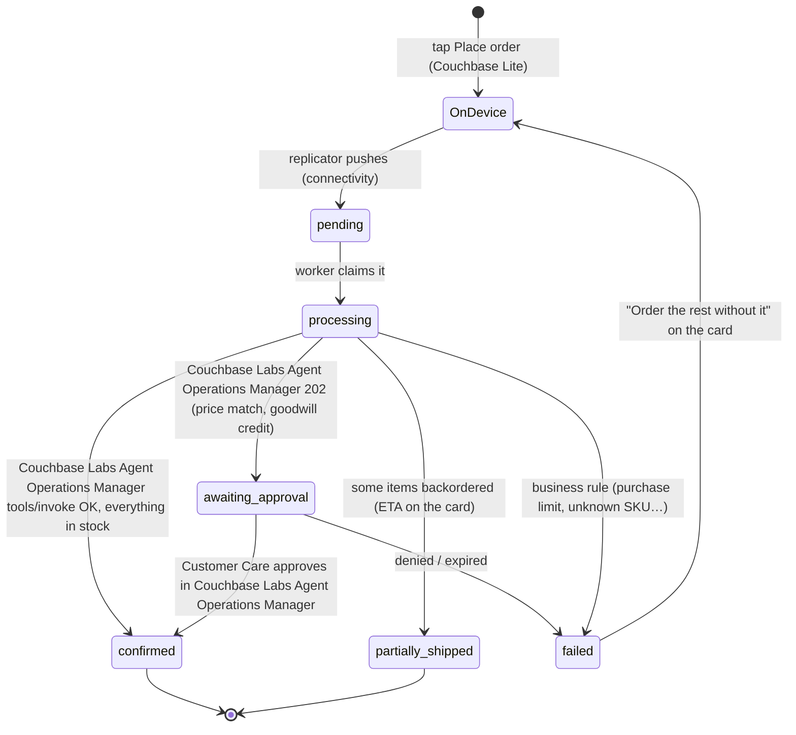

# Couchbase ShopSmart POS · Mobile AI Personalization on Couchbase


The store side of **Couchbase ShopSmart**, a fictional retailer: a drive-thru lane and a phone line that take spoken orders, and self-checkout kiosks that recognize what a guest puts down. Each is run by an AI agent, and each agent works from documents the store already holds - the catalog, the café menu, today's pricing rules, and every guest's profile and recommendations - so the lane greets a regular with their usual, the kiosk rings up an item with no barcode, and **the store keeps selling when its WAN link is down**.

It covers the retail use case **personalized customer experience and smart merchandising: voice ordering and self-service automation**.

* **Voice ordering.** The *voice ordering agent* takes orders at the drive-thru speaker and on the store's phone line. It understands the order on the store edge (a grammar over the menu and the catalog, with an LLM behind Couchbase Labs Agent Operations Manager's gateway only for what the grammar can't read), recognizes the guest (app check-in, caller ID or a spoken member number), offers their usual at their member price, and makes one merchandising offer per turn: finish the combo, the batch the kitchen overbaked, a larger size, or the item the nightly model says they are about to run out of at home.
* **Self-service automation.** The *self-checkout vision agent* turns each camera frame into a vector and finds the item with a vector search over reference vectors held on the kiosk. A clear match is rung up with no scan. Lookalikes are settled by the bagging scale, or by asking the guest. A barcode that disagrees with what the camera and the scale both see, or an item that reaches the bag unscanned, pauses checkout for the attendant, whose decision goes through Couchbase Labs Agent Operations Manager's human-approval tier.

It also has the guest's phone app on **Couchbase Lite**, the **daily Databricks export** as the only Databricks compute, targeted recommendations, dynamic pricing and bundling, and an assistant governed by the **Couchbase Labs Agent Operations Manager**. The store and the phone share one data plane, so an order taken at the lane shows up in the guest's app, comes off their store credit, and takes what they just bought out of their smart cart.

Three agents are **registered with, and governed by, Couchbase Labs Agent Operations Manager**, each with its own identity, API key and tool scope:

| Agent | Where it works | Tools it may call |
|---|---|---|
| **ShopSmart POS Assistant** | The guest's phone app | The 10 shopping tools (recommendations, quotes, orders, price matches, Subscribe & Save, returns, preferences, goodwill credits) |
| **ShopSmart POS Voice Ordering Agent** | Drive-thru lane, store phone line | `identify_guest`, `search_catalog`, `quote_cart`, `place_pos_order` |
| **ShopSmart POS Self-Checkout Vision Agent** | Self-checkout kiosks | `identify_guest`, `place_pos_order`, `resolve_checkout_exception` (approval required) |

For the assistant, Couchbase Labs Agent Operations Manager also provides the **Knowledge Base** (the Shopping Guide and one profile document per shopper), a **RAG Application** (`shopsmart-pos-assistant`), the **Context Cache** and **LLM Caching**. Every order, price match, subscription, return, goodwill credit, store order and self-checkout exception runs as an RBAC-checked, traced and audited Couchbase Labs Agent Operations Manager tool call, with human approval for price matches, goodwill credits and checkout exceptions.

There is no camera and no lane microphone in this repository. The kiosk page says which item was placed and how well the camera could see it, and the decision pipeline runs from there; the lane page uses the browser's speech recognition (or the keyboard) and the agent starts from the transcript. See [Notes](#notes).

---

## How the demo opens

`https://<host>:5154/story` is **Shopping That Knows You. Even Offline.**, a nine-chapter story for the room before the live app. Use ←/→ to move between chapters, **N** for talking points and ☾ for dark mode:

1. **A day in a shopper's pocket.** Why shoppers are offline so often: subway tunnels, parking garages, deep in the store, rural roads, airplane mode, basement apartments. It closes with Maya checking out a $496.48 cart between stations, with an offer, a bundle and the morning promotion already in the price, and a price match that needs approval.
2. **What the app needs.** Eight requirements: four for the phone, four for the AI and the data platform.
3. **The Databricks bill.** The per-request design (a warehouse query per screen, a Model Serving call per session) next to the nightly-export design. Press **Transform the stack**, or **T**, and watch "warehouse queries per day" go from 4,800,000 to 1.
4. **Offline-first, step by step.** The same cart in two phones, one with Couchbase Lite and one online-only. Press **Next step**, or Space.
5. **One data plane for the AI.** Databricks to Couchbase to the Couchbase Labs Agent Operations Manager Knowledge Base, RAG app and caches, and on to the phone - with live numbers from the running backend: warehouse queries avoided, estimated Databricks spend avoided, Context Cache and LLM cache hit rates, orders captured offline.
6. **Personalized experience and smart merchandising.** Targeted recommendations and dynamic pricing as synced documents instead of live services, with live numbers: recommendation-led revenue, automatic repricings, orders with a promotion, orders price-locked.
7. **In the store.** Voice ordering and self-checkout as two agents on the store edge, reading the same documents as the phone, with live numbers: voice orders and the time to understand and price a turn, offers accepted, items rung up with no barcode, orders held at the store through a WAN outage, attendant calls and shrink prevented.
8. **Where the Databricks money goes.** Per-request serving vs. nightly export + Couchbase, line by line.
9. **See it run.** Links to the app, voice ordering, self-checkout, the merchandising console and the Couchbase Labs Agent Operations Manager dashboard, plus a demo script.

`https://<host>:5154/lane` is **voice ordering**: pick who pulls up to the drive-thru speaker (or who is calling), then talk or type. The page shows the order screen the guest sees, the conversation, what the agent could offer next and why, how each turn was handled (what it understood, where it ran, how long it took, which documents it read), the kitchen display, the kitchen counts that drive its offers, and a lever that cuts the store's WAN link.

`https://<host>:5154/checkout` is **self-checkout**: the kiosk camera's view of each item (the vector search's top matches, the scale reading, the decision), the receipt, the prompts before paying, and the attendant's exceptions. Six situations are one click each: a normal basket, lookalikes on the scale, a lookalike held in the hand, an item barely in view, the wrong barcode, and an item that goes straight into the bag.

`https://<host>:5154/merch` is the **merchandising console**: the live rules for each fulfillment center, with levers for stock, the pricing clock and competitor prices, a log of what the engine changed and why, and what merchandising sold. None of the three consoles has a sign-in, like `/api/admin/reload`; keep the backend off the public internet.

The phone frame's side panel links back to the story. The page is served by the `web` container (`web/story.html`). Its live numbers come from `/api/status`, whose `metrics` include the Databricks offload counters (`warehouse_queries_avoided`, `model_serving_calls_avoided`, `estimated_dbx_spend_avoided_usd` at `DBX_COST_PER_QUERY_USD` per call - set it to the customer's real figure). The Couchbase Labs Agent Operations Manager link uses `AOM_DASHBOARD_URL`.

## What the demo shows

| Concept | Where you see it |
|---|---|
| **Voice ordering at the lane and on the phone** | `/lane`. "Two large iced lattes with oat milk and a breakfast burrito, no cheese" becomes two priced lines in about a millisecond. "Make that a small", "take off the burrito", "what's my total", "any deals today?" and "that's all" work the way a guest says them. The agent reads the order back with the total and what was saved, and places it on "yes". |
| **A guest the lane recognizes** | Maya checks in from the app as she turns in: "Good morning, Maya… your usual, a large oat milk latte and a bacon, egg & cheese sandwich?" Her Plus price, store credit and card on file are applied. A walk-up guest can say "my member number is 204817" mid-order and the whole order re-prices. |
| **Smart merchandising, one offer per turn** | `pos.suggestions` ranks what fits this cart, guest, hour and kitchen: **finish a combo** ("add hash browns and it's a breakfast combo: 12% off all three, so it's only $0.10 more"), a **fresh batch** the kitchen overbaked (marked down 15%), a **larger size**, and the **run-low item** from the guest's `recs::` document ("you're about a day from running out of coffee pods; there's only 1 left here"). One offer per turn, one of each kind per order, each accepted offer tagged on the order line. |
| **The kitchen drives the menu** | The store's `posstate::<store>` document holds counts for prepared items. Click **Overbaked** on the muffins: the menu board marks them down and they become the agent's next offer. Click **Sold out** on the cookies: the agent stops taking them. |
| **Recognition with no barcode** | `/checkout`. Each item placed becomes a vector; a vector search over the catalog's reference vectors (`vision::v1`, held on the kiosk) names it. A match of 80% or better that leads the runner-up by 8 points, with a scale reading that fits, is rung up at once. |
| **Lookalikes** | The 72-count and 120-count boxes of the same coffee pods score 98% and 92%. The bagging scale reads 3,188 g, which fits only one. Held in the hand with no weight to go on, the kiosk asks the guest which one; with a view too poor to trust, it asks for the barcode. It never guesses. |
| **Scans that don't add up** | Scan the cheaper earbuds' barcode with the Pro model on the tray: the camera is 98% sure of the Pro and the scale agrees, so checkout pauses with the evidence and the price difference. The attendant's decision is `resolve_checkout_exception`, which Couchbase Labs Agent Operations Manager holds on its Approvals page until a person approves. An item that skips the scanner gets a reminder first; the attendant is called only if the guest declines. |
| **The store keeps selling with the WAN down** | Click **WAN link** on either page. The lane still understands, prices and takes the order; the kiosk still recognizes, prices and takes payment. Orders become tickets marked **Held at the store**; the kitchen display shows them at once. Restore the link and they are rung up through Couchbase Labs Agent Operations Manager within a couple of seconds. |
| **One guest, every channel** | An order taken at the lane or the kiosk for a recognized guest is a document on their `shopper:<id>` channel. Their phone's Orders tab shows it, their store credit and points move, and the smart cart drops what they just bought. The one-per-household limit on the Nova X is refused at the kiosk exactly as it is in the app. |
| **Three agents, three identities** | Couchbase Labs Agent Operations Manager's Agents page lists the assistant, the voice ordering agent and the self-checkout vision agent, each scoped to its own tools. Traces and the audit log show which agent rang up each order. |
| **A shopper's whole world, on the phone** | *Home* greets the shopper with their tier, store credit and points, the cart total, "for you today" notes, what is running low and what was picked for them. *Shop* is the whole catalog, searchable offline, with member prices and the aisle at the shopper's home store. A product page shows stock at the fulfillment center, pickup at the store and why the model picked it - all from Couchbase Lite. |
| **Personalization from Databricks** | Each shopper's `recs::<id>` document is the next-basket model's smart cart (what they are about to run out of) and its picks, re-priced at the shopper's member tier (tier discount + multi-buy savings) and checked against on-hand units at their fulfillment center. The cart starts from it and it re-ranks after every order. |
| **Targeted recommendations** | *Offers for you* on Home are issued by the nightly model with the reason and the data behind each one (purchase history, loyalty tier): a category discount, a discount on an item the shopper looked at, bonus points over a basket size. Category and item offers are already in every price the shopper sees. The *Cart* works on the live basket: **finish a bundle** (what to add and what it saves), **goes with** (basket affinities), and **step up** (a bigger pack at a lower unit price, swapped in with one tap). A product page shows the same things for one item. |
| **Dynamic pricing** | `pricing::<fc>` holds the current rules for a fulfillment center: overstock markdowns (10% at 4x the normal stock level, 15% at 4.6x), items held out of promotions (15% of normal stock or less, or flagged high-demand by the forecast), competitor price caps (a competitor within 8% of list is matched automatically), and promotions by hour. The engine rebuilds it after every order and every `PRICING_REFRESH_SECONDS`, and writes it only when something changed. *Home → Today's deals*, the *Deals* filter in Shop and **How this price is built** on a product page all read it from Couchbase Lite. |
| **Dynamic bundling** | Curated bundles come from basket analysis in the export. The engine adds one of its own around the most overstocked item, and pauses any bundle the moment one of its items runs short (Devon's *New pup* bundle is paused because the dog food is sold out at his fulfillment center). |
| **A price that survives the tunnel** | The phone prices with the same arithmetic as the backend (`mobile/src/pricing.ts` mirrors `backend/app/pricing.py`; `backend/tests/test_pricing_parity.py` prices 1,200 random carts both ways and requires them to agree to the cent). Each order carries the rule version and hour it was priced at, and the backend prices it with exactly those rules for up to 48 hours. A cart built offline at 9:40 keeps the breakfast promotion when it syncs at 10:05. |
| **Merchandising console** | `/merch`: click **Overstock** or **Sell down** on an item, move the clock, or type a competitor price. The rules re-version, Sync Gateway delivers them on the `fc:<fc>` channel, and a signed-in phone re-prices within seconds. The console also shows revenue by what led to the item (smart cart, pick, cross-sell, upsell, bundle, deal, offer, browsing). |
| **Personalization the shopper controls** | *My preferences* marks categories "more of" or "hidden". It is saved offline like an order; when it syncs, the backend re-ranks the picks at once - no waiting for tomorrow's model run. |
| **Couchbase Lite: offline and online** | Tap the initials on Home and turn on *No signal* to pause replication. You can still browse, open any product, price a cart, check out (saved as an `orders` document marked **On device**), and ask the assistant. Switch it off: the order syncs and comes back **Confirmed** (or **Partially shipped** with a backorder ETA). |
| **Price match with human approval** | The export carries a competitor price watch. When a cart holds an item a competitor is beating, checkout offers a price match. It runs as `request_price_match`, which Couchbase Labs Agent Operations Manager holds as **Awaiting Customer Care** until someone approves it on Couchbase Labs Agent Operations Manager's Approvals page; then the item is re-priced, the order is placed, and the shopper's wallet, history and recommendations update on the phone. |
| **Business rules as governed refusals** | The Nova X console is limited to one per household every 30 days. The cart warns about it on the phone; an order that goes ahead anyway is refused with `reason_code: purchase_limit`, and the assistant explains the rule with the shopper's own purchase date. |
| **Databricks offload** | `/api/status → metrics` counts every profile, recommendation set, price quote and assistant context served from Couchbase instead of a warehouse query or a Model Serving call, and turns it into dollars. Chapter 5 of the story shows it live. |
| **Registered with Couchbase Labs Agent Operations Manager** | `scripts/register_with_aom.py` (or `AOM_AUTO_REGISTER` in Kubernetes) sets up the **ShopSmart POS Assistant** agent identity (role `sales_agent`, scoped to 10 tools), the **`shopsmart-pos`** MCP server, the approval tier for price matches and goodwill credits, and the **`shopsmart-pos-assistant` RAG Application**. |
| **Couchbase Labs Agent Operations Manager RAG Application** | Policy questions ("How does a price match work?") go to `POST /v1/agent/rag/shopsmart-pos-assistant/query`. Couchbase Labs Agent Operations Manager retrieves behind its Context Cache, generates behind its LLM Cache, and counts the query on the *RAG Applications* page. The app is scoped to the one *Shopping Guide* document, so a generic question can never retrieve another shopper's profile. |
| **Knowledge Base fed by the daily export** | The loader publishes the *ShopSmart Shopping Guide* plus one *Shopper profile* document per recently active shopper. The assistant always searches with a `document_id` filter, so a personal question can only be grounded in **that** shopper's profile. |
| **Context Caching** | For personal questions the assistant assembles context (the shopper's KB profile chunks, guide chunks and live tool facts: smart cart, member prices, wallet) and caches it in **Couchbase Labs Agent Operations Manager's Context Cache** (namespace `rag:shopsmart-pos-assistant:shopper-context`, key `<shopper>:<intent>:<export_date>:r<shopper rev>`). The next question is a `/v1/context/get` hit. The next export or any order changes the key, so the entry is never served stale. The same context is written to Couchbase as `ctx::<shopper>::<intent>`, which syncs to that shopper's phone; that copy is what the offline assistant answers from. Items a question names ("how much is the yoga mat?") are looked up live each turn, so a cached context never answers with another product. |
| **LLM Caching** | Guide questions contain no customer data, so the second shopper to ask the same question gets `LLM cache · exact hit`. Personal questions go through `/v1/llm/complete` in the `rag:shopsmart-pos-assistant:shopper` namespace, which Couchbase Labs Agent Operations Manager also attributes to the RAG application. |
| **Governed actions** | `place_order`, `request_price_match`, `set_subscription`, `create_return`, `update_preferences` and `issue_goodwill_credit` all run as `POST /v1/tools/invoke`. Couchbase Labs Agent Operations Manager re-checks RBAC and the agent's tool scope, traces and audits the call, scans the response, and holds price matches and goodwill credits for a person to approve. |

---

## Architecture



| # | Flow |
|---|---|
| **1** | Every morning the Databricks job drops a `dt=YYYY-MM-DD` JSON Lines partition, and the loader picks up the newest one with a `_SUCCESS` marker. Databricks is done for the day. |
| **2** | The loader upserts every shopper, builds the recommendations for every recently active shopper, publishes the catalog and one document per store, and hands the export's pricing signals to the pricing engine, which writes one rules document per fulfillment center in Couchbase Server. The assistant reads and writes its **context cache** there, the worker reads pending orders, and the MCP tools apply orders, wallet changes and preferences. |
| **3** | The loader replaces the Couchbase Labs Agent Operations Manager **Knowledge Base** documents (the Shopping Guide and one profile per recently active shopper), then re-scopes the **RAG Application** to the new guide. |
| **4** | Sign-in: the backend creates the shopper's Sync Gateway user (channels `shopper:<id>`, `store:<home store>`, `fc:<fulfillment center>`, `catalog`) and mints a session. The assistant is called over `/api`. |
| **5** | **Couchbase Lite** replicates continuously with Sync Gateway. Every screen renders from the phone, and orders become `orders` documents saved locally, even offline. |
| **6** | Guide questions go to the assistant's **RAG Application** in one call. Personal questions check Couchbase Labs Agent Operations Manager's **Context Cache**; on a miss the assistant does document-scoped **KB retrieval**, stores the context in Couchbase Labs Agent Operations Manager and Couchbase, recalls **memory**, then calls the **LLM Caching** gateway. |
| **7** | Couchbase Labs Agent Operations Manager calls the LLM provider only on a cache miss. |
| **8** | Sync Gateway carries orders up and results back down: the phone pushes its pending order, and the confirmation, backorders, updated wallet and re-ranked recommendations come back. |
| **9** | The worker runs each order as the **ShopSmart POS Assistant** agent through `POST /v1/tools/invoke`, so RBAC, tool scope, the approval tier, a trace and an audit entry are applied. |
| **10** | Couchbase Labs Agent Operations Manager calls the `shopsmart-pos` MCP server, which allocates fulfillment-center inventory, posts the order to the shopper's history and wallet and re-ranks their recommendations in Couchbase, and that syncs back to the phone (2 → 8 → 5). |

The diagram shows the guest's phone. The store's devices sit beside it, on the same Sync Gateway and the same documents:



In this repository the backend plays the lane controller and the kiosk (the pages at `/lane` and `/checkout` call it over REST), and a per-store switch stands in for the WAN link. What the agents read and write are the documents a store device would hold in Couchbase Lite.

### A drive-thru order, end to end



### A shopper's workflow, end to end

Maya (Salem, MA, Plus member) signs in at home, opens the app in a subway tunnel, adds the stand mixer to her smart cart, checks out with a price match, and the result syncs back at the top of the station stairs:



### The daily data flow



### Offline-first order lifecycle



---

## Quick start

### 1. Browser preview in about 2 minutes (no Docker, no Couchbase Labs Agent Operations Manager)

The backend can run on an in-memory store, and the app has a browser preview engine that syncs the same documents over REST. Use this to look at the UX. Couchbase Lite needs a device build (step 3).

```bash
python3 databricks/generate_mock_dump.py            # ~100 MB export → data/databricks-dump/dt=<today>/
cd backend && python3 -m venv .venv && . .venv/bin/activate && pip install -r requirements.txt
DEMO_HOUR=9 uvicorn app.main:app --port 8200        # STORE_DRIVER=memory by default; DEMO_HOUR pins the pricing clock
# new terminal
cd mobile && cp .env.example .env && sed -i '' 's/8204/8200/' .env && npm install && npx expo start --web
```

The guest app is at the Expo URL. Run from a checkout like this, the backend also serves the consoles itself: **http://localhost:8200/lane** (voice ordering), **http://localhost:8200/checkout** (self-checkout), `/merch` and `/story`. In the full stack they are served by the `web` container instead.

### 2. Full stack: Couchbase, Sync Gateway and Couchbase Labs Agent Operations Manager

You need Docker Desktop, and the [Couchbase Labs Agent Operations Manager](https://github.com/erikhinderer/couchbase-agent-operations-manager) running on the same machine at `https://localhost:8090`, with its admin password set.

```bash
cp .env.example .env
./scripts/setup-corporate-ca.sh            # only behind a TLS-inspecting proxy (Zscaler etc.)
python3 databricks/generate_mock_dump.py   # today's export → data/databricks-dump/
docker compose up -d --build               # couchbase, init, sync-gateway, sg-init, backend, web
docker compose logs -f backend             # wait for "Loaded export <date>: … shoppers"

python3 scripts/register_with_aom.py --admin-password '<Couchbase Labs Agent Operations Manager admin password>'
docker compose up -d --build backend       # picks up AOM_* from .env, publishes the KB, scopes the RAG app
```

`register_with_aom.py` is idempotent. Run it again with `--rotate` to issue a new agent key. After it runs, Couchbase Labs Agent Operations Manager shows:

* **Agents**: *ShopSmart POS Assistant* (the 10 shopping tools), *ShopSmart POS Voice Ordering Agent* (4 tools) and *ShopSmart POS Self-Checkout Vision Agent* (3 tools), all role `sales_agent`. Their keys are written to `.env` as `AOM_AGENT_API_KEY`, `AOM_VOICE_AGENT_API_KEY` and `AOM_VISION_AGENT_API_KEY`
* **Servers / Catalog**: `shopsmart-pos` (trusted) and its 13 tools
* **Knowledge**: *ShopSmart Shopping Guide <date>* and *Shopper profile S… <date>* documents
* **Approvals config**: `shopsmart-pos::request_price_match`, `::issue_goodwill_credit` and `::resolve_checkout_exception` require a human
* **RAG Applications**: *ShopSmart POS Assistant (mobile)* (`shopsmart-pos-assistant`), roles `sales_agent` and `admin`, scoped to today's guide document. Its activity counts guide queries plus the assistant's personal LLM calls and context-cache lookups, all in `rag:shopsmart-pos-assistant:*` namespaces
* **Context Cache**: entries in `rag:shopsmart-pos-assistant:shopper-context` (one per shopper and intent) and `rag:shopsmart-pos-assistant` (the RAG app's retrievals)

If the RAG application is created before the backend has published a guide, it is registered **disabled**. The backend enables it and sets its document scope on its next load. `GET http://localhost:8204/api/status` shows its state under `aom.rag_app`.

Configure an LLM provider key in Couchbase Labs Agent Operations Manager to get generated answers. Without one, Couchbase Labs Agent Operations Manager returns a labelled stub: the backend then writes the answer itself from the same retrieved context, and Couchbase Labs Agent Operations Manager still reports the LLM-cache status (hit or miss).

Then open **https://localhost:5154/story** for the story that opens the demo, **https://localhost:5154/lane** for voice ordering, **https://localhost:5154/checkout** for self-checkout, **https://localhost:5154** for the guest app in a browser, or **http://localhost:8204** for a page linking every service.

| Port | Service |
|---|---|
| `5154` | **The app in a browser** over HTTPS, behind the sign-in page (`web` service), shown inside a phone frame (add `?frame=0` for full width): same screens and documents, synced over REST instead of Couchbase Lite |
| `5154/lane`, `5154/checkout`, `5154/merch` | Voice ordering, self-checkout and the merchandising console, served by the same `web` container |
| `8204` | Backend API + MCP server (`/pos/mcp`); `/` lists every link |
| `4992` | Sync Gateway public, which is what phones replicate with: `ws://<host>:4992/pos` |
| `127.0.0.1:4993` | Sync Gateway admin |
| `127.0.0.1:18095` | Couchbase Web Console (Administrator / password123) |

**Sign-in and HTTPS.** The browser UI (the app, the story page and everything else the `web` container serves) is on **`https://<host>:5154`** and opens on a sign-in page:

| Username | Password |
|---|---|
| `demo` | `Couchbase123!` |

Change them with `DEMO_USERNAME` / `DEMO_PASSWORD` in `.env` (Compose) or `web.auth.username` / `web.auth.password` (Helm). The container serves a self-signed certificate it generates on first start, so the browser warns once; add the address people use to `TLS_HOSTS` (Compose) so it is in the certificate, or serve a real one by mounting `tls.crt` / `tls.key` at `/etc/nginx/tls` (Helm: `web.tls.secretName`). Plain `http://` on the same port redirects to HTTPS, and `/signout` ends the session. The sign-in covers the browser UI only: the backend API and Sync Gateway ports are unchanged.

Ports are chosen so this stack runs alongside Couchbase Labs Agent Operations Manager (8090, 8091-8096), the NOV demo, the cruise demos (8081/8082, 8200/8201, 4984-4986), the field sales demo (8083, 8202, 4988) and the ShopSmart app demo (8084, 8203, 4990). Its Couchbase Labs Agent Operations Manager ids (`shopsmart-pos`, `shopsmart-pos-assistant`, the three *ShopSmart POS* agents) are its own, so it registers next to the ShopSmart app demo in the same Couchbase Labs Agent Operations Manager.

### 3. The app on a device with Couchbase Lite

Couchbase Lite is a native module, so it needs a **development build**; Expo Go can't load it, the same as mobile_field_service. `npm install` runs `scripts/fetch-cbl-native.sh`, which fetches the `cbl-reactnative` native submodules that npm skips.

```bash
cd mobile
cp .env.example .env                       # API + Sync Gateway URLs (LAN IP for a physical phone)
npm install
npx expo run:ios -d "iPhone 16 Pro"        # or: npx expo run:android
npm run start:ios                          # later runs: Metro on localhost
```

The `web` service serves a prebuilt browser bundle (`web/dist.tgz`). After changing the app, rebuild it with `cd mobile && npm run export:web:docker`, then `docker compose up -d --build web`.

With `EXPO_PUBLIC_DB_ENGINE=auto`, the app uses Couchbase Lite whenever the native module is linked. *Account → Offline & sync* (tap the initials on Home) shows the database path, the Sync Gateway endpoint, the replicator status, how many documents are waiting to send and what is on the phone. The same notes as mobile_field_service apply: Xcode 26.4+ needs `plugin.fmt.js` (included), and there is a simulator keyboard toggle (⌘K).

### 4. Kubernetes with Helm (K3s / Rancher)

`deploy/k8s/deploy.sh` deploys Couchbase Labs Agent Operations Manager (**agent-ops**) and this demo (**pos-app**) onto a single-node K3s cluster, such as one managed by Rancher, without a container registry. Run it from your Mac, in this repository:

```bash
AOM_ADMIN_PASSWORD='<12+ characters>' ./deploy/k8s/deploy.sh      # MOTHER=ehind@192.168.111.4 by default
# mother already runs Couchbase Labs Agent Operations Manager and the other demos: add this one next to them
AOM_ADMIN_PASSWORD='<current Couchbase Labs Agent Operations Manager password>' ONLY=pos ./deploy/k8s/deploy.sh
```

To deploy on **hal** (192.168.111.5), where Couchbase Labs Agent Operations Manager already runs in `agent-ops`:

```bash
AOM_ADMIN_PASSWORD='<current Couchbase Labs Agent Operations Manager password on hal>' TARGET=hal ONLY=pos ./deploy/k8s/deploy.sh
```

`TARGET` picks the ssh host and the values file (`deploy/k8s/values-hal.yaml`); `MOTHER=` and `VALUES=` override either. `deploy/k8s/values-mother.yaml` publishes this demo on **8085 / 8204 / 4992** so it can run alongside `royal-app` (8081 / 8200 / 4984), `princess-app` (8082 / 8201 / 4986) and the field sales demo (8083 / 8202 / 4988). They all register with the same Couchbase Labs Agent Operations Manager under different ids, so they show up side by side on Couchbase Labs Agent Operations Manager's Agents, Servers and RAG Applications pages.

It runs four steps:

1. **Build.** It builds the three Couchbase Labs Agent Operations Manager images from `AOM_DIR` (default `~/github-couchbaselabs/couchbase-agent-operations-manager`) and this demo's `pos-backend` and `pos-web` images, for the node's CPU architecture.
2. **Import.** It copies the images over SSH and imports them into K3s's containerd. This asks for your sudo password on the node once.
3. **Install.** It runs `helm upgrade --install` on the node for both charts, and installs helm into `~/.local/bin` there if it's missing:
   * `aom` in namespace `agent-ops`, from Couchbase Labs Agent Operations Manager's own chart with `values-k3s.yaml`
   * `pos-app` in namespace `pos-app`, from [`helm/pos-app`](helm/pos-app) with [`deploy/k8s/values-mother.yaml`](deploy/k8s/values-mother.yaml)
4. **Secrets.** The Couchbase Labs Agent Operations Manager admin password and any `ANTHROPIC_API_KEY` / `OPENAI_API_KEY` / `GEMINI_API_KEY` go into mode-600 values files on the node, never onto a command line.

| Resource in `pos-app` | What it does |
|---|---|
| `couchbase` StatefulSet + `couchbase-init` hook Job | Couchbase Server EE 8.0.2. The Job runs the same `init.sh` as Compose |
| `sync-gateway` + `sg-init` hook Job | Sync Gateway 4.0.4. `sync-gateway-public` exposes the replication port for Couchbase Lite |
| `backend` | Loads the export into Couchbase and serves the MCP server. Self-registers with Couchbase Labs Agent Operations Manager (`AOM_AUTO_REGISTER`) |
| `databricks-dump` PVC | Holds the export. The backend's init container exports today's 100 MiB partition on first start |
| `databricks-daily-export` CronJob | 04:30 America/New_York: exports a new partition and keeps the newest 2. The backend picks it up within 5 minutes |
| `web` | The phone-framed app. nginx proxies `/api` to the backend, so the browser needs only one URL |

**Self-registration.** No register script is needed in the cluster. With `AOM_AUTO_REGISTER=true`, the backend signs in to Couchbase Labs Agent Operations Manager (setting `AOM_ADMIN_PASSWORD` as the first-login password on a fresh Couchbase Labs Agent Operations Manager), registers `shopsmart-pos` at `http://backend.pos-app.svc.cluster.local:8200/pos/mcp`, issues the three agents and keeps their keys in Couchbase, turns on the approval tier, and publishes the Knowledge Base and the RAG application. Progress is in `/api/status` under `aom.registration`.

| URL on the node (192.168.111.4) | |
|---|---|
| `https://…:3111` | Couchbase Labs Agent Operations Manager dashboard (`admin` / `AOM_ADMIN_PASSWORD`) |
| `https://…:5154/story` | The story: start here |
| `https://…:5154` | The app |
| `https://…:5154/lane` | Voice ordering |
| `https://…:5154/checkout` | Self-checkout |
| `https://…:5154/merch` | The merchandising console |
| `http://…:8204/api/status` | Backend status, Databricks offload counters |
| `ws://…:4992/pos` | Sync Gateway for Couchbase Lite (point a device build's `EXPO_PUBLIC_SG_URL` here, and `EXPO_PUBLIC_API_URL` at `:8204`) |

---

## Demo script (about 15 minutes)

The figures below are for the pricing clock at **9 am** (`DEMO_HOUR=9`, the default in Docker Compose and Helm; for the browser preview start the backend with `DEMO_HOUR=9 uvicorn …`), so the morning promotion is on whenever you give the demo. Open `/lane`, `/checkout` and `/merch` in other windows before you start. Do the store steps (1 and 2) first: the phone steps that follow change Maya's wallet and smart cart, and the figures here assume the morning's export.

1. **The lane** (`/lane`, ShopSmart Salem)
   * Click **Maya Chen**. The agent greets her by name and offers her usual; the right-hand panel shows how she was recognized, her wallet and her offers. Say or tap **Yes please**: a large oat milk latte at $5.06 (list $5.95, less 5% Plus and the 10% morning coffee run) and the sandwich.
   * The agent offers the **breakfast combo**: hash browns for $0.10 more, because 12% comes off all three. **Sure**. It then offers the **coffee pods** her `recs::` document says she is a day from running out of, and notes there is one box left. **Yes**.
   * **That's all** → the agent reads the order back: **$45.27**, saving $5.23. **Yes** → "$32.77 on your Visa ending in 4417 after $12.50 store credit. Pull forward to the window." The ticket appears on the kitchen display and flips to **Rung up**; with Couchbase Labs Agent Operations Manager connected the panel shows the trace id of `shopsmart-pos::place_pos_order`, called by the voice ordering agent.
   * Open the guest app as Maya (**204817** / **Chen**): *Orders* shows *Drive-thru · Maya · 4 items*, her store credit is $0, and the coffee pods have left her smart cart.
   * Click **A guest we don't know** and say "two large iced lattes with oat milk and a breakfast burrito, no cheese", then "make that a small", then "my member number is 427190": the order re-prices at Sofia's Premier tier. Under *Kitchen counts* click **Overbaked** on the muffins and order a coffee for the next guest: the offer is now the fresh batch at 15% off.
   * Click **WAN link** to cut it and take another order. Every turn still answers in about a millisecond; the ticket says **Held at the store**. Click it again: the ticket is rung up.
2. **The kiosk** (`/checkout`)
   * As *Not a member*, click **A normal basket**: four items, four camera matches at 99%, no barcodes. Click **Lookalikes on the scale**: 98% against 92%, settled by the 3,188 g on the scale. Click **A lookalike held in the hand**: with no weight to go on, the kiosk asks which box of diapers it is.
   * Click **The wrong barcode**: the cheaper earbuds' barcode with the Pro model on the tray. Checkout pauses, and the *Attendant* panel shows the evidence and the $57.00 difference ($179.99 against the $122.99 the cheaper model sells for today). Click **Ring up what's on the tray**: with Couchbase Labs Agent Operations Manager connected the exception waits on Couchbase Labs Agent Operations Manager's *Approvals* page, and the receipt changes only when a person approves it there.
   * Click **Straight into the bag**, then **Yes, add it**: a reminder, no attendant. **Pay**.
   * Switch to **Maya · Plus** and place the paper towels: the kiosk prices them at her tier and prompts her to finish the clear-out bundle with the aisle to walk to. Switch to **Sofia · Premier** in Plano and place the Nova X: the kiosk warns about the purchase limit, and paying is refused with `purchase_limit`, the same rule as in the app.
3. **Maya Chen** (member **204817** / **Chen**, Salem MA, Plus)
   * The figures in this step are for Maya before the lane order in step 1. After it her store credit is $0 and the coffee pods are out of her smart cart, so the totals differ; `POST /api/admin/reload` does not undo orders, so restart the backend (memory mode) or reload the bucket to rehearse from the morning's export.
   * *Home*: "Good morning, Maya", Plus member, $12.50 store credit, 1,840 points. Her cart is already filled from the model: 8 items, **$253.99**. *For you today*: diapers, coffee pods and paper towels are about to run out; only 1 box of coffee pods is left at the Northeast fulfillment center; Brightway Market has the stand mixer for $239.99; and an offer, 10% off Baby. *Offers for you* shows that offer ("You've bought diapers 6 months running", from purchase history) and 500 bonus points on $150 or more (from her loyalty tier). *Today's deals*: the morning coffee run, paper towels at 15% off because the center holds 5.5x its normal stock, and the bundles.
   * Tap her initials → *No signal* **on**. Open *Cart*. The diapers and wipes carry "Your offer · 10% off" and "Baby essentials bundle · 8% off"; the coffee pods say "Selling fast - not in promotions" (one box left, so the engine pulled them from the morning promotion). Under *Add before you check out*, tap **Add ToughLine Tall Kitchen Trash Bags**: it completes the clear-out bundle the engine built around the overstocked paper towels and saves $5.28. Open the diapers to show **How this price is built**.
   * *Shop* → search "mixer" → open it: $265.99 at Plus (list $279.99), aisle F10 at ShopSmart Salem, "Viewed 4 times this month · 93% confidence". **Add to cart** → *Cart*: 10 items, the price-match switch is on, **$510.04** after the match, tax and store credit, and it earns 1,482 points including the 500 bonus. Every number was computed on the phone. **Place order with price match** → **On device**. Ask the assistant "Any deals for me today?" → **Answered on device · Couchbase Lite**.
   * Switch *No signal* **off**: the order syncs, Couchbase Labs Agent Operations Manager holds it → **Awaiting Customer Care**. Approve it in Couchbase Labs Agent Operations Manager → *Approvals*; the card flips to **Partially shipped** for the same $510.04 (one box of coffee pods is backordered - the ETA is on the card), her store credit drops to $0, and the bonus-points offer disappears from Home because it was one-time. In Couchbase Labs Agent Operations Manager, show the trace and audit entry for `shopsmart-pos::request_price_match`.
   * Ask "How does a price match work?" twice: `Context cache · hit` and `LLM cache · exact hit`. Open **sources**: the Shopping Guide. Ask "What goes with the air fryer?" for a cross-sell answer with the bundle price.
4. **The merchandising console** (`/merch`, with Maya still signed in next to it)
   * *What merchandising sold* already shows Maya's order split by smart cart, bundle and browsing, and one order price-locked.
   * On the phone, tap **Fill with my smart cart** (or add anything from Shop) so there is a cart to re-price.
   * Find *Casa Verde Extra Virgin Olive Oil* and click **Overstock**: the row turns red at 15% off, the change log explains why, and within a few seconds the item appears under *Today's deals* on her phone. Click **Sell down** on the paper towels: the markdown ends, promotions on them pause, and the engine rebuilds its clear-out bundle around the next most overstocked item.
   * Click **18** on the pricing clock. On the phone the greeting changes, the morning promotion is gone, and the Cart's delivery card offers *Skip the rush*: 5% off everything for store pickup during the delivery peak. Type a competitor price a little under list for any item to see it matched automatically; type one far under list and nothing changes, because a gap that large needs a person (the price-match approval in step 1). **Reset the demo** puts everything back.
5. **Devon Walker** (**318552** / **Walker**, Rhinebeck NY, Member): asks the same price-match question and gets an **LLM cache exact hit** from Maya's turn, because the guide namespace is shared and has no customer data. His smart cart is $185.88 and leads with dog food, which is out of stock at the Hudson Valley fulfillment center, so the *New pup* bundle is paused there; his offer is 15% off the pet bed he looked at twice. Place the order → **Partially shipped**, both bags backordered. Open the dog food and put it on **Subscribe & Save**; it leaves the smart cart.
6. **Sofia Alvarez** (**427190** / **Alvarez**, Plano TX, Premier): her smart cart is $183.47. *Shop* → "console" → add the Nova X: it is flagged high demand, so it is never promoted, and the product page and the cart warn that her household bought one six days ago. **Place the order anyway** → refused with `purchase_limit`; **Order the rest without it** places the remainder. Ask "Why can't I buy a second console?". Ask "My delivery arrived damaged" → **Request $15 goodwill credit** (held for approval). Open *Tune* next to "Picked for you", hide Electronics and favor Home & kitchen: her picks re-rank on the next sync.
7. Finish on **story chapters 5, 6 and 7**: the counters moved because of what you just did. Every one in chapter 5 is a Databricks query that didn't run, chapter 6 shows the revenue that came through a recommendation, and chapter 7 shows the store selling with no cloud call on the path.

---

## The Databricks export

`databricks/generate_mock_dump.py` writes the exact layout the Databricks notebook produces: Spark JSON Lines part files, `_SUCCESS`, and a `_manifest.json`.

```bash
python3 databricks/generate_mock_dump.py --export-date 2026-11-13 --target-mb 100 --parts 4
```

* **About 13,000 shoppers** across 50 home stores in 8 regions, 100 MiB, deterministic for a given `--seed` on a given Python version. Each part is about 25 MB, under GitHub's 50 MB warning. Every shopper is synthetic.
* One line is **one shopper**: identity, address, home store, household, the ShopSmart Rewards membership (tier, discount, renewal), the wallet (store credit, points, masked payment method), delivery defaults and fulfillment center, preferences, app engagement with a note on where they lose signal, the recent orders with lines, month-to-month replenishment per SKU, 12-month spend, subscriptions, and **`ml_scores`** from `shopsmart-next-basket-v2.3`.
* `ml_scores` holds the per-category affinities, churn risk, predicted basket value, days-to-runout per SKU, the smart-cart lines with a confidence each, recommended items with a reason each, the competitor price watch, segment, next best offer and **`offers`**: the personal offers the model issues, each with a kind (`category_pct`, `sku_pct`, `bonus_points`), the reason shown to the shopper, the data that drove it, an expiry date and whether it is one-time.
* **`_pricing_signals.json`** sits beside the part files: competitor prices per SKU, the SKUs the demand forecast expects to outrun supply, the promotions by hour, the curated bundles, and the basket affinities behind cross-sell (`pairs_with`) and upsell (`upgrades`). The pricing engine combines it with live inventory. An export without the file keeps the previous day's signals.
* Three hand-built **demo shoppers** are always the first rows, with every date relative to the export date so the story is the same in every daily export.
* `databricks/notebooks/shopper_personalization_daily_export.py` is the production equivalent: Customer 360 joins, MLflow model scoring, a Delta table, and the JSON export to a Unity Catalog volume. `databricks/jobs/…job.json` schedules it daily at 04:30 America/New_York. It is the only Databricks compute the app uses; after it finishes the warehouse can auto-stop.

The loader only needs a folder with a newer `dt=*/_SUCCESS` to appear. You can sync the Volume down with `databricks fs cp -r`, or mount the cloud storage behind it into the backend container at `/data/databricks-dump`.

---

## Data model

Bucket `pos`, scope `retail`. Sync Gateway replicates the first seven collections to Couchbase Lite (same scope and collection names on the phone). A shopper's SG user gets the `shopper:<id>`, `store:<home store>`, `fc:<fulfillment center>` and `catalog` channels. A store device's SG user would get `store:<id>`, `fc:<fc>`, `catalog` and `store-devices`.

| Collection | Document | Channel | Written by | Notes |
|---|---|---|---|---|
| `shoppers` | `shopper::<id>` | shopper | loader, actions | The export row + `rev` (bumped on every order, wallet change, subscription, return, preference change) |
| `stores` | `store::<id>` | store | loader | Hours, services, pickup time and the aisle of every SKU. A phone only holds its shopper's home store |
| `recommendations` | `recs::<shopper>` | shopper | personalization | Smart cart lines priced with the current rules and fulfillment-center on-hand, "for you" picks, price matches, the shopper's usable `offers`, "for you today" notes |
| `orders` | `order::<shopper>::<uuid>` | shopper | **the phone** (create), worker (status) | Offline-first queue for every shopper action. The sync function allows `requireUser(shopper_id)`, `status: pending` and creation only |
| `orders` | `ticket::<store>::<uuid>` | store (+ shopper when the guest is recognized) | voice and vision agents (create), worker (status) | A store order: `type: request`, `origin: pos`, `tool: place_pos_order`, the lines, the agent, the kitchen and bag lists. `status` is `on_edge` while the store's WAN link is down, then `pending` → `confirmed`. The sync function lets only the backend write one |
| `assistant` | `chat::<shopper>` | shopper | assistant | History + answers reusable offline (keyed by the question) |
| `context_cache` | `ctx::<shopper>::<intent>`, `ctx::<shopper>::guide_<intent>` | shopper | assistant | Phone copy of the **Context Cache** entry also held in Couchbase Labs Agent Operations Manager: KB chunks + tool facts, `export_date`, `shopper_rev`, TTL 6h |
| `catalog` | `catalog::v1` | catalog | loader | Products, member tiers, multi-buy savings, delivery options, competitors, fulfillment centers, FAQ, and the basket affinities behind cross-sell (`pairs_with`) and upsell (`upgrades`) |
| `catalog` | `pricing::<fc>` | fc | pricing engine | The pricing rules for one fulfillment center: `sku_rules` (overstock, no_promo, competitor cap), `time_rules`, `bundles`, the discount cap, the pricing clock, on-hand units per SKU, and a `version` hash of the rules. A phone holds only its own center's document |
| `catalog` | `vision::v1` | store-devices | vision agent | The reference vector (24 dimensions, cosine) and shelf weight of every catalog item. What the kiosk searches |
| `inventory` | `inv::<fc>` | — | actions | On-hand units per SKU per fulfillment center (CAS updates). Server only |
| `lookups` | `login::…`, `kbdoc::…`, `load_state`, `pricing_signals`, `pricinghist::<fc>::<version>`, `posstate::<store>`, `voice::<session>`, `kiosk::<session>`, `aom_agent*` | — | loader, pricing engine | Login index, KB document ids, load status, the pricing engine's inputs, and every rule version of the last 48 hours (TTL) for the price lock. Also each store's edge state (WAN link, kitchen counts, recent tickets), lane and kiosk sessions (TTL 2h) and the agents' Couchbase Labs Agent Operations Manager keys. Server only |

The `shopsmart-pos` MCP server has 13 tools. Ten are the shopping tools of the app: `get_shopper_context`, `get_recommendations`, `search_catalog`, `quote_cart`, `place_order`, `request_price_match` (approval required), `set_subscription`, `create_return`, `update_preferences` and `issue_goodwill_credit` (approval required). Three are for the store: `identify_guest` (who is at the lane, on the phone or at the kiosk: tier, wallet, usual, run-low items, offers), `place_pos_order` (ring up a drive-thru, phone or self-checkout order of retail and menu lines, price-locked to what the store device quoted) and `resolve_checkout_exception` (approval required). `place_pos_order` and `resolve_checkout_exception` run only from a ticket or kiosk session the backend wrote for a store device: the worker refuses them from a phone, and the sync function refuses a phone that tries to write a ticket. Run `scripts/register_with_aom.py` again after pulling a change to the tools so Couchbase Labs Agent Operations Manager has the new definitions. Every shopping tool takes the `shopper_id` it acts for; the worker fills it from the order document, which Sync Gateway only accepted from that signed-in shopper.

Pricing is the same arithmetic in two places, so a cart is right with or without signal: `backend/app/pricing.py` (`quote`) + `actions.py` (`_totals`) on the server and `mobile/src/pricing.ts` on the phone. A line's price is list price minus the sum of its percentages (member tier, multi-buy 3+ / 6+, overstock markdown, the hour's promotion, a personal offer, a bundle), capped at 40% off, then capped at a matched competitor price, then at an approved price match. Totals add 6.25% tax, the delivery fee, store credit and points (plus bonus points). Rounding follows Python's, including exact half cents.

Store orders use the same engine. Retail lines go through `pricing.quote` priced as a store pickup. Menu lines (`backend/app/menu.py`: 15 items, sizes, modifiers, two combos) take the same kinds of adjustment in `pos.price`: member tier, a fresh-batch markdown from the kitchen counts, the promotion for the hour (the morning coffee run matches the `coffee` and `breakfast` tags), and a combo, added together up to the same 40% cap. Totals are `actions._totals` for a recognized guest (store credit, points, bonus offers) and list less public promotions plus tax for a walk-up guest.

### The store API

What `/lane` and `/checkout` call. No sign-in: in a store these calls come from the lane controller and the kiosks on the store network.

| Call | |
|---|---|
| `POST /api/voice/session` `{store_id, channel: drive_thru\|phone, shopper_id?, member_number?, identified_by?}` | Start a lane or phone session. Returns the greeting and the session view |
| `POST /api/voice/session/{id}/turn` `{text}` | One utterance in, the reply to speak out, plus the priced cart, the pending offer, the trace of the turn and the ticket |
| `GET /api/voice/session/{id}` | The session view (polled for the ticket status) |
| `POST /api/kiosk/session` `{store_id, kiosk?, shopper_id?, member_number?}` | Start a checkout |
| `POST /api/kiosk/session/{id}/event` `{kind, data}` | `place` `{sku, barcode?, view: clear\|occluded\|poor, on_scale}`, `bag` `{sku}`, `answer` `{choice}`, `remove` `{sku}`, `add_suggestion` `{id}`, `loyalty` `{member_number}`, `pay` |
| `POST /api/kiosk/session/{id}/exceptions/{exception}/resolve` `{decision: charge_as_seen\|accept_scan\|remove, attendant}` | The attendant's decision, through Couchbase Labs Agent Operations Manager's approval tier |
| `GET /api/pos/store/{store}` · `/menu` | The store's WAN link, kitchen counts, tickets and counters; the menu board priced now |
| `POST /api/pos/store/{store}/simulate` `{action: wan_down\|wan_up\|set_kitchen\|reset, sku?, value?}` | The store's levers |

```bash
S=$(curl -s localhost:8204/api/voice/session -H 'content-type: application/json' -d '{"store_id":"ST-0101","shopper_id":"S00101001"}' | python3 -c 'import json,sys; print(json.load(sys.stdin)["session_id"])')
curl -s localhost:8204/api/voice/session/$S/turn -H 'content-type: application/json' -d '{"text":"yes please"}' | python3 -m json.tool | head -40
```

---

## Configuration

Backend variables go in `.env` (see `.env.example`); `docker-compose.yml` sets the infrastructure ones.

| Variable | Default | |
|---|---|---|
| `STORE_DRIVER` | `memory` (compose: `couchbase`) | `memory` keeps the first `MEMORY_SHOPPER_LIMIT` shoppers (1,500), which always include the demo shoppers |
| `RECS_WINDOW_DAYS` | `1` | Recommendations are pre-built for shoppers who opened the app this recently; everyone else gets theirs at sign-in |
| `AOM_URL`, `AOM_AGENT_API_KEY` | — | The assistant's agent identity, written by `register_with_aom.py` |
| `AOM_VOICE_AGENT_API_KEY`, `AOM_VISION_AGENT_API_KEY` | — | The store agents' identities, written by the same script. Without one, that agent acts under the assistant's key |
| `AOM_ADMIN_USERNAME`, `AOM_ADMIN_PASSWORD` | — | Used only to publish KB documents |
| `AOM_LLM_PROVIDER`, `AOM_LLM_MODEL` | Couchbase Labs Agent Operations Manager default | Pin the model completions use |
| `KB_WINDOW_DAYS`, `KB_PROFILE_LIMIT` | `2`, `150` | Which shoppers get a KB profile each day (the demo shoppers always do) |
| `CONTEXT_CACHE_TTL_SECONDS` | `21600` | Upper bound; the export date and shopper rev invalidate it sooner |
| `RAG_APP_ID` | `shopsmart-pos-assistant` | Couchbase Labs Agent Operations Manager RAG Application id; `RAG_APP_ENABLED=false` skips it |
| `LLM_NAMESPACE_SHOPPER` / `_GUIDE` | `rag:shopsmart-pos-assistant:shopper` / `:guide` | Keep the `rag:<app_id>:` prefix so Couchbase Labs Agent Operations Manager attributes the activity to the app |
| `CONTEXT_NAMESPACE` | `rag:shopsmart-pos-assistant:shopper-context` | Couchbase Labs Agent Operations Manager Context Cache namespace for shopper context |
| `DBX_COST_PER_QUERY_USD` | `0.035` | Illustrative cost per warehouse / Model Serving call behind the story's "spend avoided" counter |
| `PRICING_TZ` | `America/New_York` | The time zone the promotions by hour run on. Phones use the same zone, not their own |
| `DEMO_HOUR` | unset (Compose and Helm: `9`) | Pins the pricing clock to an hour 0-23 so the demo script's numbers hold at any time of day. Set it to an empty value for wall time. The console can move the clock while the demo runs |
| `PRICING_REFRESH_SECONDS` | `60` | How often inventory is re-read into the rules. Orders and console changes re-price at once |
| `DEMO_TODAY` | export's `export_date` | Keeps "about to run out" stable whenever you demo |
| `SG_PUBLIC_URL` | — | Replication URL handed to phones |

App variables (`mobile/.env`): `EXPO_PUBLIC_API_URL`, `EXPO_PUBLIC_SG_URL`, `EXPO_PUBLIC_DB_ENGINE` (`auto` · `cbl` · `preview`).

---

## Tests

```bash
cd backend && pytest -q          # 49 tests (the phone/server pricing parity test needs Node and mobile/node_modules, and is skipped without them)
cd mobile && npm run typecheck
```

`test_demo_flows.py` covers sign-in, what syncs to a shopper's phone (their own profile, recommendations and home store, nobody else's), member pricing, the price-match order and its partial shipment, the price-match guardrails, the assistant's context cache (hit, guide path, live item lookup), backorders, Subscribe & Save, the purchase limit, preferences re-ranking the picks, returns and goodwill credits going to store credit, push authorization and the Databricks offload counters. `test_merchandising.py` covers the pricing rules built from inventory, the hour and competitor prices, what reaches a phone on the `fc:` channel, personal offers and their one-time redemption, bundles (applied, paused, and the one the engine builds), the price lock, cross-sell and upsell data, source attribution in the metrics, the console's levers and the assistant's deals answers. `test_aom_integration.py` runs the backend against `tests/fake_aom.py`, which has the same routes and shapes as Couchbase Labs Agent Operations Manager. It checks KB publishing, document-scoped retrieval, RAG application registration and its guide-only scope, shopper context cached through Couchbase Labs Agent Operations Manager's Context Cache, the LLM cache shared across shoppers for guide questions but not personal ones, tool calls over real MCP, and the approval tier. `test_aom_bootstrap.py` starts the backend with `AOM_AUTO_REGISTER` against a *fresh* fake Couchbase Labs Agent Operations Manager and checks that it registers itself end to end. `test_pos.py` runs the store side against its own backend process: the grammar (quantities, sizes, modifiers before and after the item, retail items by their everyday names), a recognized guest's usual, combo offer and run-low item with the prices behind them, the lane order arriving on the guest's phone, a member number re-pricing a walk-up order, kitchen counts driving the offer and the 86, a phone order for pickup, the lane selling through a WAN outage and the ticket releasing afterwards, the vector search and the decision for every catalog item, lookalikes with and without the scale, the barcode swap and the missed scan, the purchase limit at the kiosk, and a phone being refused the store tools. `test_aom_integration.py` also checks that a drive-thru order and a checkout exception run through Couchbase Labs Agent Operations Manager under the voice and vision agents' own identities, and that the exception changes nothing until a person approves it.

---

## Repository layout

```
backend/            FastAPI API, MCP server, loader, worker, assistant (Python)
  app/catalog.py        products, household types, member tiers, fulfillment centers, regions, stores (shared with the generator)
  app/personalization.py  the smart cart, picks and price matches per shopper
  app/pricing.py        the merchandising rules engine: inventory + hour + competitor data -> pricing::<fc>, quote(), price lock
  app/actions.py        order / price-match / subscription / return / preference business logic behind every tool
  app/menu.py           the café menu: items, sizes, modifiers, combos, kitchen pars, each guest's usual
  app/pos.py            the store: pricing a store cart, merchandising suggestions, place_pos_order, tickets, the WAN link and kitchen counts
  app/voice.py          the voice ordering agent: grammar, dialog, offers, LLM fallback through Couchbase Labs Agent Operations Manager
  app/vision.py         the self-checkout vision agent: reference vectors, vector search, the decision, exceptions
  app/agents.py         the three Couchbase Labs Agent Operations Manager agent identities and their tool scopes
  app/assistant.py      intent → Couchbase Labs Agent Operations Manager RAG app (guide) | Couchbase Labs Agent Operations Manager Context Cache → KB + memory + LLM cache (shopper) → actions
  app/rag_app.py        the assistant's Couchbase Labs Agent Operations Manager RAG Application definition, re-scoped daily
  app/loader.py         daily export → Couchbase (shoppers, recommendations, stores) + Couchbase Labs Agent Operations Manager Knowledge Base
  app/worker.py         offline-first orders → Couchbase Labs Agent Operations Manager tools/invoke
  app/metrics.py        story counters, including the Databricks offload
  app/aom_bootstrap.py  self-registration with Couchbase Labs Agent Operations Manager (Kubernetes)
mobile/             Expo app (Couchbase Lite engine + browser preview engine)
  src/theme.ts          the Couchbase palette
  src/pricing.ts        the same pricing arithmetic on the phone, plus bundle nudges, cross-sell and upsell for the cart
  assets/images/        the Couchbase logo (as supplied, plus a white-wordmark variant and the round mark for icons)
databricks/         mock export generator, PySpark notebook, daily job
couchbase-init/     bucket / scope / collections / indexes
sync-gateway/       bootstrap + database config with per-collection sync functions
scripts/            register_with_aom.py, setup-corporate-ca.sh
web/                nginx image serving the browser build of the app over HTTPS on :5154, behind the sign-in page (proxies /api to the backend), the story page, voice ordering (lane.html), self-checkout (checkout.html) and the merchandising console (merch.html)
helm/pos-app/ Helm chart for the demo (Couchbase, Sync Gateway, backend, daily export CronJob, web)
deploy/k8s/         deploy.sh + values for the K3s nodes (Couchbase Labs Agent Operations Manager and the demo)
data/               the daily export drop folder
```

## Notes

* **No camera, no lane microphone.** The vision agent's inputs are simulated: an item's "frame" is its reference vector plus noise that grows as the view gets worse, and the scale reads its shelf weight within 1.2%. The reference vectors themselves are generated (items that are the value size or pro model of another share most of their vector, which is what makes them lookalikes); a real deployment embeds product images with a vision model. The search is brute-force cosine in Python over `vision::v1`; in production it is a Couchbase vector index, or Couchbase Lite vector search on the kiosk. The decision logic (`vision.decide`) is real and is what the tests exercise.
* **Speech.** The lane page uses the browser's speech recognition and speech synthesis where the browser has them (Chrome sends audio to its own speech service) and the keyboard otherwise. A lane device would run speech-to-text locally. The agent starts from the transcript either way, and "to understand and price a turn" excludes speech-to-text.
* **The store edge is simulated.** The backend plays the lane controller and the kiosk, and a per-store switch plays the WAN link: with it down, tickets wait as `on_edge` and nothing is sent to Couchbase Labs Agent Operations Manager. The device builds (Couchbase Lite on a lane controller or a kiosk) are not in this repository; the documents, channels and sync function they would use are.
* **The menu and the usuals are not in the export.** The café menu lives in `backend/app/menu.py`. The three demo shoppers' usual orders are written there by hand and everyone else's is derived from their shopper id; in production the usual is one more column of the nightly export.
* **Store consoles have no sign-in.** `/api/voice/*`, `/api/kiosk/*` and `/api/pos/*` are open, like the merchandising console. They can place orders for any shopper id, so keep the backend off the public internet.
* **Shrink figures are illustrative.** "Shrink prevented" adds up the price differences of exceptions settled in the store's favor and of missed scans a guest accepted. It is a demo counter, not a loss-prevention claim.

* **Pricing is illustrative.** The thresholds (4x stock for a markdown, 8% for an automatic competitor match, a 40% cap) are constants in `backend/app/catalog.py`, chosen to make the demo readable, not pricing advice. Personalized and time-based pricing is regulated in some markets; the demo keeps promotions as discounts off a public list price and shows the shopper how each price is built.
* **The price lock trusts the phone's hour.** An order names the rule version and hour it was priced at, and the backend honors any version from the last 48 hours. A production build would bound how old a locked price may be and check the claimed hour against when the order was created.
* **Rule documents carry stock.** `pricing::<fc>` includes on-hand units per SKU so product pages can show stock offline, which means it re-syncs after every order at that center. At production volume, split stock into its own document or round it into bands.

* **Brand.** The palette follows couchbase.com (Couchbase red on white, near-black type) and the app, story page and icons use the Couchbase logo from `mobile/assets/images/couchbase-logo.png`. The red in `mobile/src/theme.ts` is sampled from that logo. Swap the file to change the logo everywhere in the app; the story page embeds its own copy.
* **ShopSmart is fictional.** The retailer, its products and house brands, its stores, the competitors it price-matches and every shopper are invented for the demo. Prices, inventory, membership terms and policies are illustrative. There is no product photography: items are shown as category tiles.
* **Databricks numbers.** The offload counters are a demo instrument: they count reads the app served from Couchbase that a per-request design would have sent to a SQL warehouse or Model Serving endpoint, at a flat `DBX_COST_PER_QUERY_USD`. Replace the rate with the customer's blended per-query cost (DBU rate × warehouse size ÷ queries per hour, plus egress) before quoting a figure.
* **Couchbase licensing.** Couchbase Server EE and Sync Gateway EE images run under the free developer license for dev and test. Shipping Couchbase Lite with encryption requires an Enterprise license, the same as mobile_field_service.
